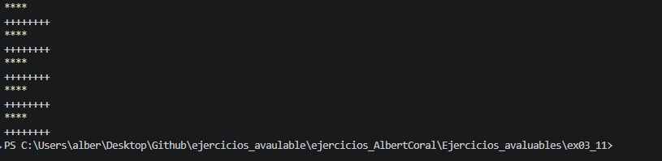

# Ejercicio 3.11 (`ex03_11.cpp`)

## Explicación del funcionamiento

Este programa ejecuta un bucle `while` que cuenta del 1 al 10. En cada iteración evalúa si el número actual (`count`) es impar o par mediante el operador módulo `count % 2 == 1`:

* **Si es impar** (1, 3, 5, 7, 9): Imprime `****`.
* **Si es par** (2, 4, 6, 8, 10): Imprime `+++++++++`.

## Salida esperada en pantalla

```text
****
+++++++++
****
+++++++++
****
+++++++++
****
+++++++++
****
+++++++++
```

## Captura del resultado de la ejecución

