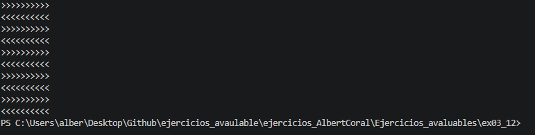

# Ejercicio 3.12 (`ex03_12.cpp`)

## Explicación del funcionamiento

Este programa utiliza dos bucles `while` anidados para dibujar un patrón de 10 filas por 10 columnas:

* El bucle exterior controla las filas (`row`), empezando en 10 y descendiendo hasta 1.
* El bucle interior imprime 10 caracteres por cada fila (`column` de 1 a 10).
* Si la fila (`row`) es un número impar, imprime `<`. Si la fila es un número par, imprime `>`.

Dado que empieza en `row = 10` (par) y va bajando, alternará filas completas de `>` y `<`.

## Salida esperada en pantalla

```text
>>>>>>>>>>
<<<<<<<<<<
>>>>>>>>>>
<<<<<<<<<<
>>>>>>>>>>
<<<<<<<<<<
>>>>>>>>>>
<<<<<<<<<<
>>>>>>>>>>
<<<<<<<<<<
```

## Captura del resultado de la ejecución

