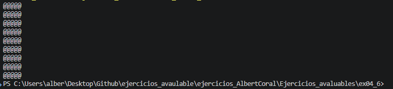

# Ejercicio 4.6 (`ex04_06.cpp`)

## Explicación del funcionamiento

Este programa utiliza dos bucles `for` anidados para dibujar un patrón de caracteres `@` en la consola:

- **Bucle exterior (`i`):** Se ejecuta 10 veces (desde `i = 1` hasta `i = 10`), lo que representa las 10 filas del patrón.
- **Bucle interior (`j`):** En cada iteración del bucle exterior, se ejecuta 5 veces (desde `j = 1` hasta `j = 5`), imprimiendo un carácter `@` por cada iteración sin salto de línea.
- Tras imprimir los 5 caracteres `@`, el bucle exterior ejecuta `cout << '\n';` para pasar a la siguiente línea.

Como resultado, el programa imprime un rectángulo de 10 filas y 5 columnas compuesto completamente por símbolos `@`.

## Salida esperada en pantalla

```text
@@@@@
@@@@@
@@@@@
@@@@@
@@@@@
@@@@@
@@@@@
@@@@@
@@@@@
@@@@@
```

## Captura del resultado de la ejecución

